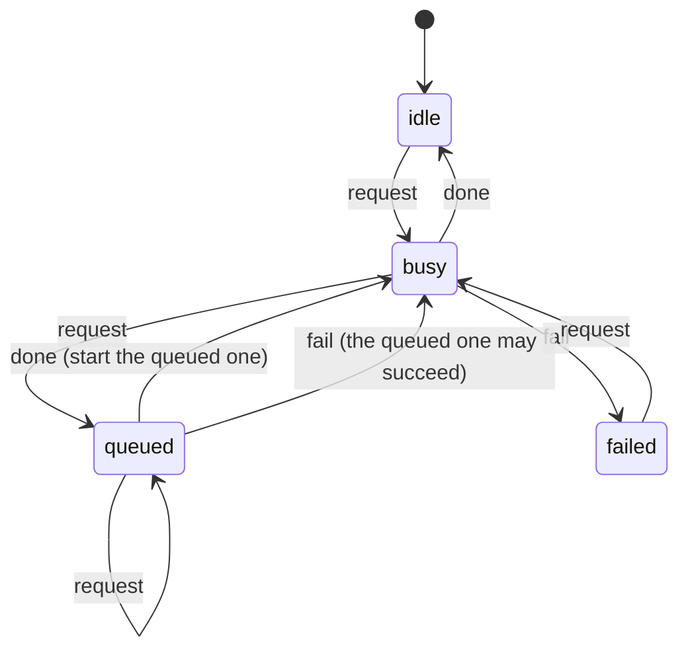

# Front ends: Studio (HTML + Python) and Glass GL (WebGL)

## Problem

The Gradio UI drifted out of sync with itself. A UI simulator
(`tools/simulate_ui.py`) reproduced, from scripted users:

- the board kept showing the previous photo after a new upload;
- typing a grid size (no slider `release`) left painted cells on the old grid;
- an empty or negative seed crashed every handler;
- output came back at the detection scale (4032 px in, 2016 px out);
- min distortion above max crashed the render;
- one tab's distortion settings leaked into every other tab and user through
  the global `Config`;
- batch processing overwrote the originals when input and output folders
  were the same.

The first three come from state that several handlers set directly. The rest
are core bugs and are fixed in `utils/` for every caller.

## Two versions

| | Studio | Glass GL |
|---|---|---|
| Rendering | Python (`utils/`), the reference physics | Fragment shader port of the same physics |
| Face detection | Haar cascade on the server | MediaPipe face detector in the browser, plus drawn boxes |
| Photo leaves the device | Only to the local server (127.0.0.1) | Never |
| Slider feedback | One request per change, latest wins | Every frame |
| Served at | `/studio/` | `/gl/` |

Both are served by `server/app.py` and share `frontend/shared/`: the state
machine helper, the state tables, settings validation, presets, cell layout
and board geometry. The material, tint and palette lists in
`frontend/shared/model.js` are checked against `GET /api/materials` by a
test, so the two renderers cannot drift apart silently.

## Constraints

- Full-resolution output: detection may run on a downscaled copy; boxes are
  mapped back and glass is rendered at the original resolution.
- No global mutable render settings: every render receives its settings.
- Every input is validated at the boundary (`normalizeSettings` in the
  browser, pydantic models on the server).
- The server keeps at most `MAX_PHOTOS` decoded photos (LRU). An evicted
  photo is not an error: the client still holds the file and re-uploads.
- The studio server binds to 127.0.0.1 only.

## State machines

Rendering reads state; handlers send events; a move missing from a table is
refused and, in loud mode (localhost or `?dev=1`), shown as a console error
and an on-page toast.

### Photo

```mermaid
stateDiagram-v2
    [*] --> empty
    empty --> loading: choose
    loading --> ready: found
    loading --> noFaces: none
    loading --> failed: fail
    loading --> loading: choose (newer file wins)
    ready --> loading: choose
    ready --> loading: expire (server evicted it; re-upload)
    ready --> ready: addFace
    noFaces --> ready: addFace
    noFaces --> loading: choose
    failed --> loading: choose
    ready --> empty: reset
    noFaces --> empty: reset
    failed --> empty: reset
```

Exits: every state can choose another photo; `failed` and `noFaces` explain
why and offer a retry or drawing a face box by hand.

### Render

Latest wins: at most one render in flight and at most one queued.



`sync` is allowed from any state in both machines and replays a known state,
for example after the server evicted a photo.

### Layout (data, not a machine)

The painted cells always carry the grid they were painted on. Changing the
grid by any means (drag, typing, preset) resamples the painting onto the new
grid: each new cell takes the style of the old cell under its centre. A fully
painted face (preset, paint all) stays fully painted and a partial pattern
keeps its place, while every cell is recomputed, so stale coordinates cannot
exist. (The first version emptied the layout instead, which turned a preset
back into random tiles on any grid change.)

## What survives a reload

| Thing | Survives | Why |
|---|---|---|
| Settings and brush | Yes, `localStorage` | Per-viewer convenience |
| Photo | No | It is a private local file; it is never stored |
| Painted cells | No | Tied to the photo's faces |

## Measuring

- `tools/simulate_ui.py`: scripted and random users against the Gradio UI
  (kept as the regression record of the bugs above).
- `tools/simulate_api.py`: random and rude clients against the studio API
  (stale photo ids, eviction, bad settings, concurrent renders) with p50/p95
  render latency.
- `node --test frontend/shared/`: the state tables as pure data, plus a
  random walk that must never hit a refused move from designed UI actions.
